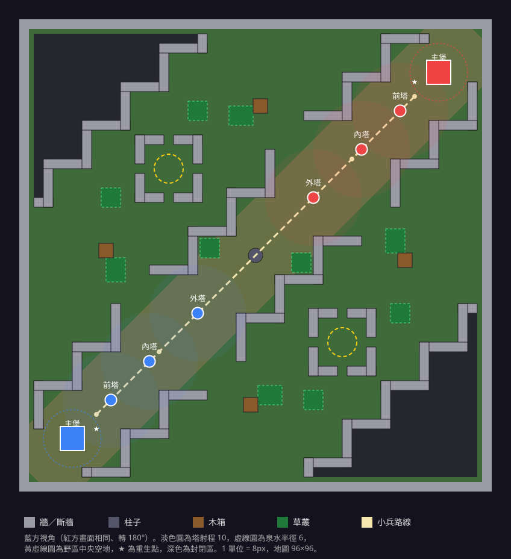

# arena_v2 地圖草圖

| 項目 | 內容 |
|---|---|
| 狀態 | 已確認並實作（2026-11-10，D17～D19） |
| 對應功能 | [F5 地圖 v2](../features/f5-map-v2.md)、[F7 草叢](../features/f7-vision.md) |
| 產生方式 | `python3 tools/maps/arena_v2_layout.py` 寫入 `src/data/maps/arena_v2.json` 與本頁的 SVG；加上 `<輸出目錄>` 時只輸出 SVG、PNG 預覽與佈局 JSON |
| 地面圖 | `python3 tools/maps/bake_ground.py` → `public/env/arena_v2/ground-{blue,red}.png`（見 [assets.md](../assets.md#製作紀錄)） |

圖為藍方視角：藍方主堡在左下、紅方在右上。紅方玩家看到的畫面完全相同（整張轉 180°）。

## 設計重點

1. **點對稱**：只設計藍方那一半，紅方由 (x, z) → (−x, −z) 產生。兩隊的塔距、草叢、野區入口完全相同。
2. **一條斜向主路**：從主堡到主堡的對角線。主路兩側是 L 形斷牆組成的階梯，寬度在 14～25 之間變化，凹處可以躲人。
3. **兩塊野區**：在主路兩側，各有兩個入口，一個靠藍方、一個靠紅方，位置左右對稱。野區中央是四角斷牆圍成的空地，四邊都有開口。野區外側的角落封閉、不能走，免得地圖太空曠。
4. **牆一律與座標軸平行**：像素貼圖要正對鏡頭（見 `src/core/view.ts`）。斜向的邊界用階梯表現，不用斜牆。
5. **每隊 3 座塔**，依序攻擊（D15）：外塔 → 內塔 → 主堡前塔 → 主堡。

## 座標與距離（藍方；紅方取負號）

| 物件 | 位置 | 備註 |
|---|---|---|
| 主堡 | (−38, −38) | 碰撞 5×5；泉水半徑 6 |
| 主堡前塔 | (−30, −30) | 射程 10 |
| 內塔 | (−22, −22) | 射程 10 |
| 外塔 | (−12, −12) | 射程 10 |
| 英雄出生點 | (−36, −40) | 重生位置再往中央移 7 → (−36, −33)，在泉水內 |
| 小兵出生點 | (−33, −33) | 主堡前方。目前小兵生在主堡正中，加了碰撞會卡住，所以分開 |
| 小兵中繼點 | (−33,−33) → (−20,−20) → (20,20) → (33,33) | 沿主路中線；中央柱與塔由移動碰撞繞過 |
| 野區入口 | (−7, −25)、(25, 7) | 左上野區；右下野區為 (7, 25)、(−25, −7)。每個入口寬約 8.5，內側有木箱與草叢 |
| 野區中央空地 | (18, −18) | 四角斷牆圍出 12×12，四邊各有開口；先空著，預留給之後的野怪或目標點 |
| 中央柱 | (0, 0) | 半徑 1.5 |

| 距離 | 數值 |
|---|---|
| 地圖 | 96×96（外牆內可走 92×92） |
| 主堡到主堡 | 直線 107.5，步行（每秒 5）約 21.5 秒 |
| 重生點走到敵方主堡前 | 約 19 秒 |
| 兩座外塔之間 | 33.9（射程 10，中間留約 14 的空地） |
| 外塔 → 內塔 → 前塔 → 主堡 | 14.1 → 11.3 → 11.3 |
| 野區寬度（垂直主路） | 約 31 |
| 草叢 | 每隊 5 叢：主路凹處 1、野區入口內側 2、空地外圍 2 |

## 實作時的影響

- **地圖檔**：佈局腳本改成直接輸出 `src/data/maps/arena_v2.json`。`demo_arena` 保留當測試圖。
- **地圖格式**：
  - `entities` 新增 `creep_spawn`（小兵出生點）。
  - 新增 `lanes`（中繼點）與 `brush`（矩形）兩個欄位。
  - 塔多一個 `order`，從外塔 1 到前塔 3，主堡是 4。
- **移動碰撞**：牆、柱子、木箱、塔、主堡都會擋路，只看水平面。英雄與小兵用移動佔位半徑（英雄 0.4、小兵 0.35）做圓形與矩形／圓形的推開，貼牆時沿牆滑動。
- **小地圖**：大小改讀地圖的 `size`，並畫出牆與封閉區。
- **鏡頭**：地圖變大，鏡頭高度不變。視野內的範圍維持現狀，靠小地圖補資訊。

## 確認結果（2026-11-10）

1. **野區沒有野怪**：先不加，中央空地保留（D18）。
2. **野區入口**：每塊維持 2 個（D19）。
3. **封閉角落**：照草圖封起來。封閉區在地圖檔裡是 `deadZones`（矩形），移動碰撞當成障礙物，地面畫成深色裂岩。
